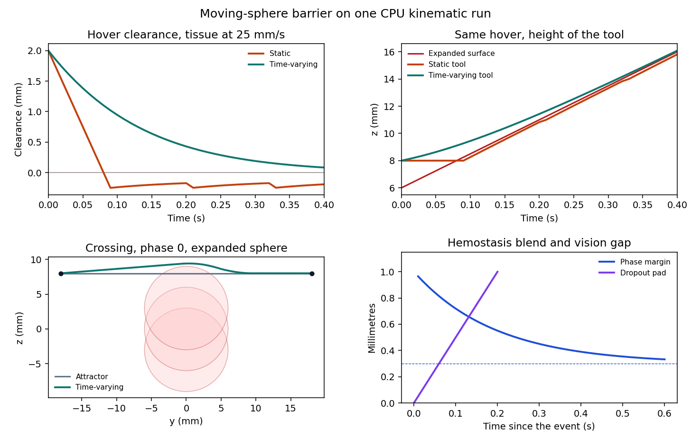

# deformable-cbf-bench

Kinematic benchmark for a no-go sphere that moves. A static barrier uses the current centre. A time-varying barrier puts the sphere velocity in the same half-space, then refuses a 10 ms step that would finish inside the margin.

This is a benchmark, not a clinical device. It does not read an endoscope recording and it does not start a simulator. The numbers below are one CPU run. [docs/BENCHMARK_RESULTS.md](docs/BENCHMARK_RESULTS.md) is that run, copied from [BENCHMARK_RESULTS.md](BENCHMARK_RESULTS.md). [docs/PRD.md](docs/PRD.md) is the requirement. [docs/TECHNICAL_REPORT.md](docs/TECHNICAL_REPORT.md) is the implementation. [docs/PAPER.md](docs/PAPER.md) is the same run as a technical note.

## Demo

```powershell
pip install -r requirements.txt
python -m deformable_cbf.bench
python -m deformable_cbf.figures
streamlit run app.py --server.address 127.0.0.1 --server.port 8506
```

The board is local only, at [http://127.0.0.1:8506](http://127.0.0.1:8506). Metric cards are the recorded run. The tissue-speed slider and the phase slider recompute the same integrator. They do not rewrite the table.

Orange is the static tool. Teal is the time-varying tool. The pale line on the crossing is the unfiltered attractor. Pink disks are the expanded sphere at the bottom, middle, and top of the 3 mm bob. The lower-right panel is a different clock: the position margin after a switch to hemostasis, and the pad added when a vision frame is missing.



Recorded run:

| Question | Result |
| --- | --- |
| Hover, sphere rising at 25 mm/s, command held at 0 | Static clearance −0.250 mm. Time-varying clearance +0.083 mm. |
| Crossing, 3 mm bob at 0.3 Hz, eight phases | Attractor loses the margin on 3 / 8 (worst −0.994 mm). Static, time-varying, and replan lose it on 0 / 8. |
| Filter time | About 0.5 ms mean around the call on this run. Inside a 10 ms period. Not a server percentile. |

## 1. Time-varying ellipsoid

The nominal command $`u_{\mathrm{nom}}`$ is a saturated attractor. The filter keeps the integrated command close to it while the exterior of each obstacle stays forward invariant. For obstacle $`i`$,

```math
h_i(x, t) = (x - p_i)^\top Q_i (x - p_i) - 1.
```

$`Q_i`$ already includes the margin. A sphere of anatomical radius $`r`$ and margin $`m`$ uses $`Q = I/(r+m)^2`$, so $`h = 0`$ is the expanded sphere and $`h \lt 0`$ is the interior. Along $`\dot x = u`$,

```math
\dot h_i = 2(x - p_i)^\top Q_i (u - \dot p_i) + (x - p_i)^\top \dot Q_i (x - p_i).
```

The safe command satisfies $`\dot h_i + \alpha h_i \ge 0`$, which is the linear inequality $`A_i u \le b_i`$ with

```math
A_i = -2\bigl(Q_i(x - p_i)\bigr)^\top,
```

```math
b_i = \alpha h_i - 2(x - p_i)^\top Q_i \dot p_i + (x - p_i)^\top \dot Q_i (x - p_i).
```

The nearest command is

```math
\begin{aligned}
\min_u \quad & \tfrac12 \|u - u_{\mathrm{nom}}\|^2 \\
\text{s.t.} \quad & A u \le b.
\end{aligned}
```

The static call is this program with $`\dot p`$ and $`\dot Q`$ set to zero. The episodes then take a 10 ms Euler step. If the barrier at the predicted next state is negative, speed is added along the outward normal, up to 40 mm/s. On the hover, omitting $`\dot p`$ spends one period of a 25 mm/s approach and the clearance reaches −0.250 mm. Including it, the tool retreats and the clearance stays at +0.083 mm.

Clearance in the table is the Euclidean gap, $`c = \|x - p\| - r - m`$, which is negative on the same set as $`h`$ for this sphere.

## 2. Where the two filters tie

The crossing sphere bobs by 3 mm at 0.3 Hz. Its peak speed is 5.65 mm/s. Both filters receive a tangent slide before the quadratic program. Both keep the margin on all 8 phases and reach the target. The unfiltered attractor loses the margin on 3 phases. A 0.5 s hand-written replan does not change the filtered counts. The hover, not this bob, is the comparison that separates the filters.

## 3. A slower measurement, and a phase

These two blocks live in `deformable_cbf/core` and use metres. The episodes above use millimetres. They are not added together in the scored runs.

A dropped vision frame leaves the deviation $`y`$ from a slow baseline on

```math
\ddot y + \gamma \dot y + \omega_b^2 y = 0, \qquad \omega_b = 2\pi f_b,
```

with $`f_b = 0.3`$ Hz. The integral stops at 200 ms. Confidence at or below 0.4 does not reset the clock. The extra margin grows as

```math
\delta(\tau) = 0.5\,\mathrm{mm}\cdot \frac{\tau}{0.1\,\mathrm{s}}.
```

A phase switch blends the position margin by 5% of the remaining gap on each 10 ms tick,

```math
d \leftarrow (1-\lambda)d + \lambda d^\star, \qquad \lambda = \min(1, 5\Delta t).
```

The first tick from dissection (1.0 mm) toward hemostasis (0.3 mm) lands at 0.965 mm. The force cap of the new phase changes on that tick. A separate solver also enforces $`|u_j| \le u_{\max}`$. If the barrier and the box have no point in common, the command is the barrier solution clipped to the box.

## Experiments

| Experiment | Comparison | Recorded result |
| --- | --- | --- |
| Hover | Static half-space versus tissue velocity in the half-space | −0.250 mm versus +0.083 mm |
| Crossing | Attractor versus either barrier, eight phases | 3 / 8 violations versus 0 / 8 |
| Dropout | Accepted frame versus confidence 0.1 | 0.5 mm at 100 ms; the dim frame does not clear the timer |
| Phase | One 10 ms step after the switch to hemostasis | 0.965 mm, not 0.3 mm |
| Speed box | 0.20 m/s command, no barrier row | Clipped to 0.05 m/s |

## Layout

```text
deformable_cbf/          millimetre plant, barrier, traces, figure
deformable_cbf/core/     metre predictor, phase blend, speed box
app.py                   local board
docs/figures/            board figure used above
docs/PRD.md
docs/TECHNICAL_REPORT.md
docs/PAPER.md
docs/BENCHMARK_RESULTS.md
```

## References

Ames, Xu, Grizzle, and Tabuada, "Control barrier function based quadratic programs for safety critical systems," IEEE Transactions on Automatic Control, 2017, is the quadratic program in section 1. This repository solves that program by active-set enumeration on a 3-vector, then repairs the finite step. The attractor is not a trained flow field. No surgical robot interface is loaded.
